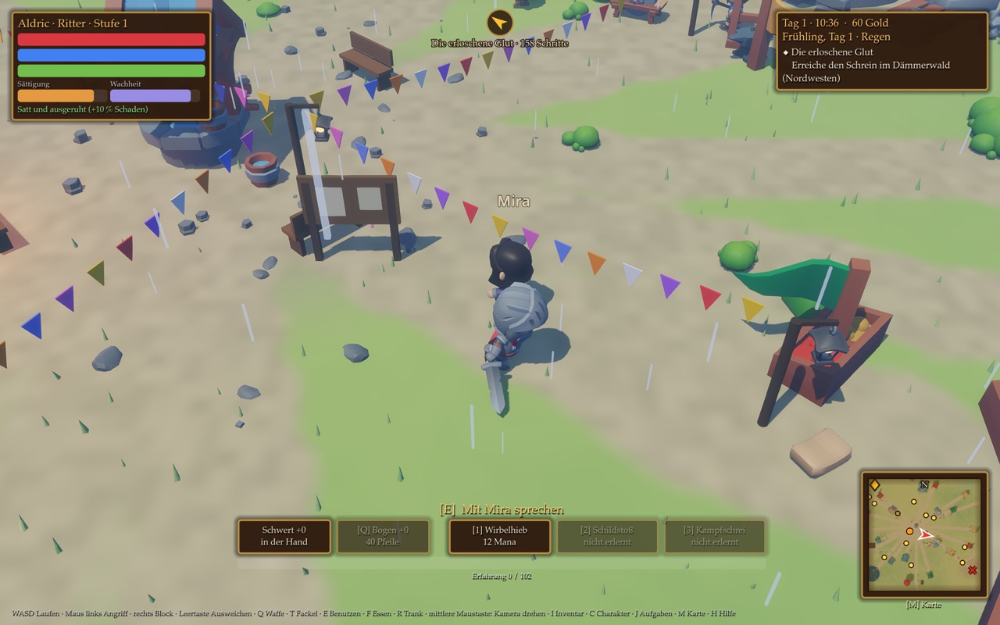
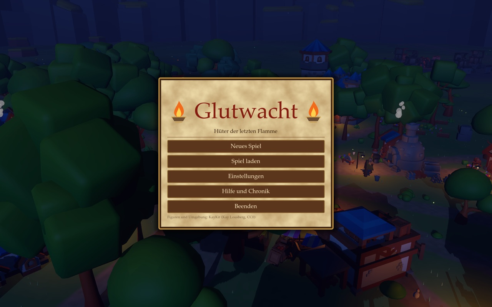
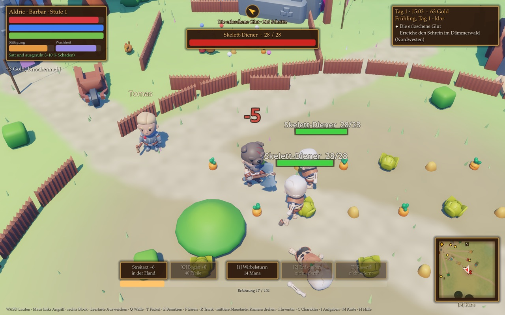
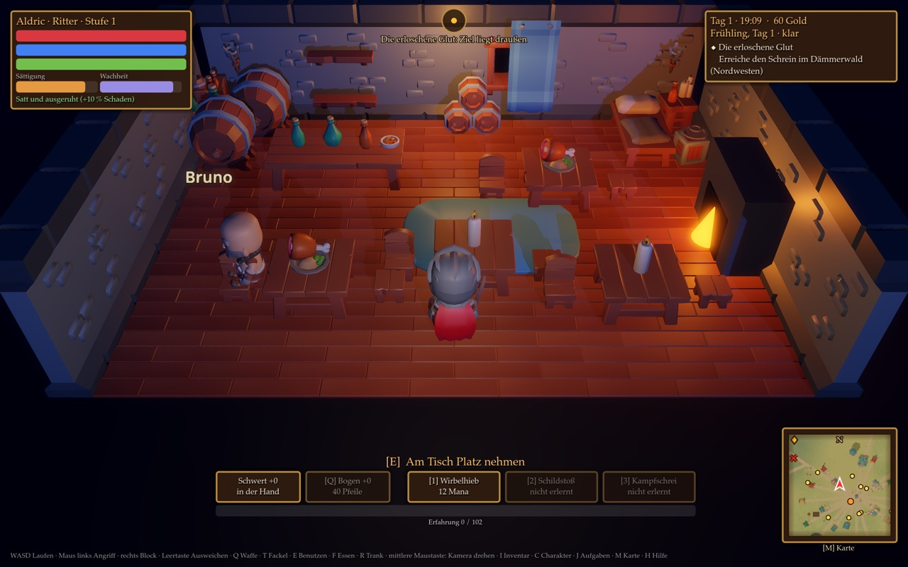
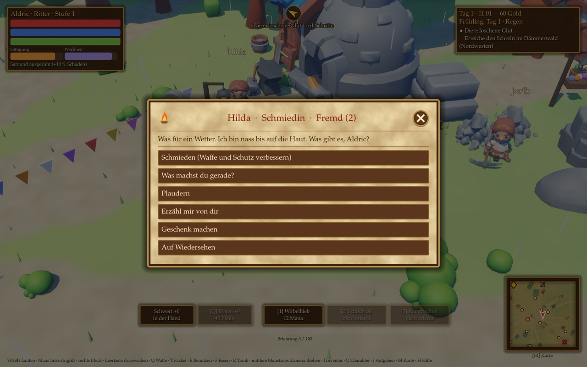
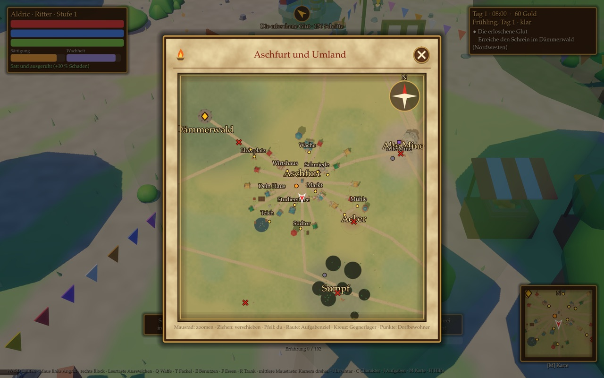
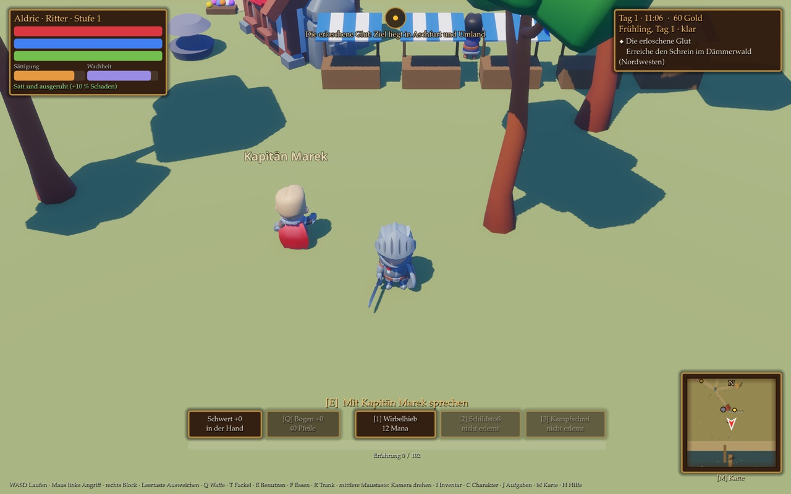
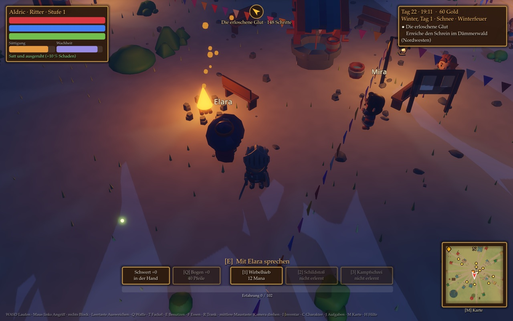

# Glutwacht – Hüter der letzten Flamme

Ein 3D-Action-Rollenspiel in einer kleinen, bunten Fantasywelt. Du bist der letzte Anwärter der Glutwacht und sollst die erloschenen Glutschalen des Landes neu entzünden. Unterwegs kämpfst du gegen Skelette, Wölfe und Räuber, handelst zwischen vier Dörfern, richtest dein eigenes Haus ein und findest vielleicht die große Liebe.

**Testfassung** · Sprache Deutsch · Windows und Linux (64 Bit) · gebaut mit [Godot 4](https://godotengine.org)



## Was dich erwartet

- **Offene Welt** mit dem Dorf Aschfurt, Wäldern, Mine, Sumpf, Ruinen und Friedhof, dazu drei weitere Dörfer auf eigenen Karten (Salzhafen, Hochwacht, Dornfeld) und die Aschenlande.
- **Geschichte in drei Akten** mit Entscheidungen und drei verschiedenen Enden, dazu viele Nebenaufgaben.
- **Fünf Klassen:** Ritter, Barbar, Magierin, Schurkin, Waldläufer. Stufen, Attribute, Fähigkeiten und Talente.
- **Kampf** mit Mauszielen, schweren Angriffen, Blocken, Ausweichen, zwei Waffenslots, Bogen und Pfeilen.
- **Lebendige Dörfer:** Die Bewohner haben keinen Stundenplan, sondern Hunger, Müdigkeit und Launen und entscheiden selbst, was sie tun. Man kann mit ihnen reden, ihnen Geschenke machen, flirten und heiraten.
- **Alltag:** Essen und Schlafen, Wetter, Jahreszeiten, Feste und Markttage.
- **Eigenes Haus** mit Truhe, Herd, Möbeln, Garten und Hühnerstall. Berufe, Handel mit Ortspreisen, Turnier, Alchemie, Schatzkarten.
- **Dungeons** mit Fallen, Hebeln und Endgegnern. Ohne Fackel ist es dort stockfinster.

## Herunterladen und starten

1. Unter [Releases](https://github.com/JPPeterson-lab/Glutwacht/releases/latest) die ZIP-Datei für dein System herunterladen.
2. Entpacken. Die Programmdatei und `Glutwacht.pck` müssen im selben Ordner liegen.
3. Starten:
   - **Windows:** Doppelklick auf `Glutwacht.exe`. Windows warnt beim ersten Start, weil die Datei nicht signiert ist: „Weitere Informationen“, dann „Trotzdem ausführen“.
   - **Linux:** Im Ordner `chmod +x Glutwacht.x86_64` und dann `./Glutwacht.x86_64`.

Das Spiel braucht eine Grafikkarte mit Vulkan-Unterstützung. Auf Laptops hilft es, in den Einstellungen die Grafikqualität und die Bilder pro Sekunde zu senken.

Spielstände liegen unter `%APPDATA%\Godot\app_userdata\Glutwacht` (Windows) bzw. `~/.local/share/godot/app_userdata/Glutwacht` (Linux).

## Erste Schritte

1. **Neues Spiel**, einen der drei Spielstände wählen, dann Klasse, Name, Attribute und Schwierigkeit.
2. Hauptmann Gernot wartet bei der Wache im Norden von Aschfurt. Der **Kompass** oben in der Bildmitte zeigt immer zum Ziel der aktuellen Aufgabe.
3. **Dein Haus** steht westlich vom Brunnen. Dort kannst du schlafen (das speichert auch), kochen und Dinge in der Truhe lagern.
4. Achte auf **Sättigung und Wachheit** (links oben): Hungrig und übermüdet kämpfst du schlechter.
5. Nachts und in Dungeons hilft eine **Fackel** (Taste T).
6. Die Taste **H** öffnet die Hilfe mit Erklärungen zu allem, was das Spiel kann.

## Steuerung

| Taste | Aktion |
|---|---|
| W A S D | laufen, mit Umschalt sprinten |
| linke Maustaste | angreifen (lange halten: schwerer Angriff) |
| rechte Maustaste | blocken |
| Leertaste | ausweichen |
| 1 2 3 | Fähigkeiten |
| Q | Waffe wechseln |
| E | benutzen und sprechen |
| F / R | essen / Heiltrank |
| T | Fackel |
| I · C · J · M · H | Inventar · Charakter · Aufgaben · Karte · Hilfe |
| mittlere Maustaste ziehen | Kamera drehen und neigen (oder Y und X) |
| Mausrad | Kamera zoomen |
| Esc | Menü |

Alle Tasten lassen sich in den Einstellungen ändern.

## Bilder

| | |
|---|---|
|  |  |
|  |  |
|  |  |
|  | |

## Aus dem Quelltext starten

Mit installiertem [Godot 4.7](https://godotengine.org/download) im Projektordner:

```bash
godot --path .
```

## Lizenzen

Programmcode, Spieltexte sowie die selbst erzeugte Musik und die Klänge stehen unter der [MIT-Lizenz](LICENSE). Die 3D-Modelle und Animationen stammen von [KayKit](https://kaylousberg.com) (Kay Lousberg) und sind gemeinfrei (CC0). Einzelheiten in [LIZENZEN.md](LIZENZEN.md).
